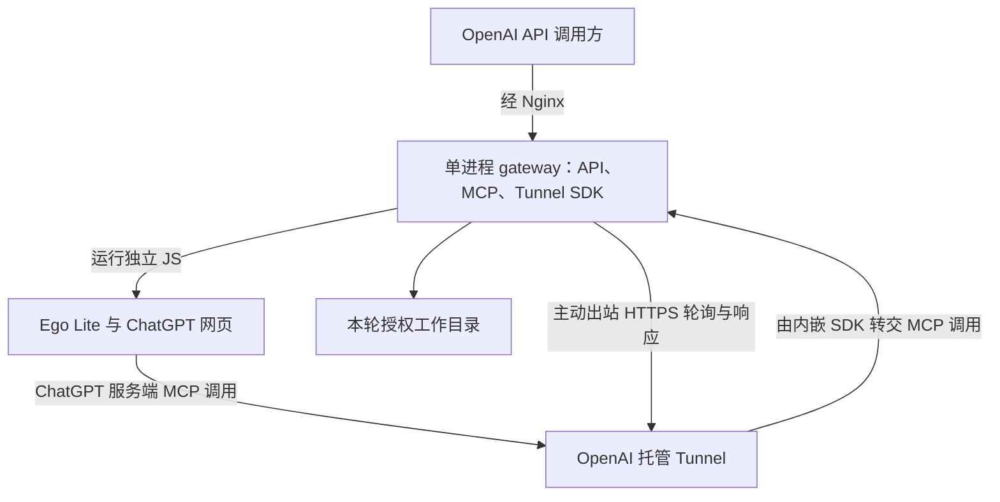
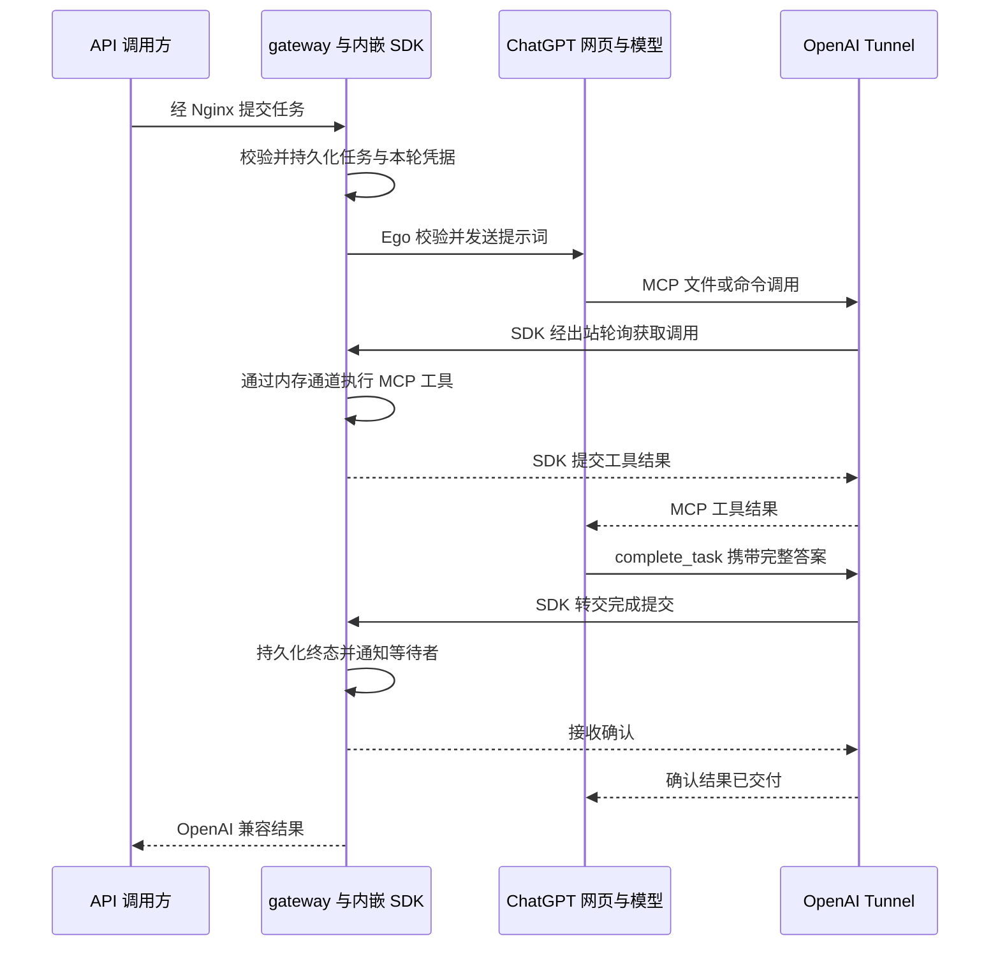

# gptweb2api 技术方案与实施计划

- 目标仓库：https://github.com/kk2land/gptweb2api
- 整理日期：2026-10-28（Asia/Shanghai）
- 状态：方案设计，尚未实现或完成账号环境实测。
- 依据：本次讨论、参考项目文档与关键源码，以及 OpenAI、Ego 的官方文档。

## 1. 目标与已确定的设计

在本地运行一个兼容部分 OpenAI API 的服务。调用方提交任务后，由本地服务通过 Ego Lite 控制已登录的 ChatGPT 网页；网页中的模型通过自定义 MCP 插件操作本地项目，并将最终答案通过 MCP 回传给等待结果的 API 调用方。

已确定的设计如下：

1. 使用 OpenAI Secure MCP Tunnel 连接 ChatGPT 与本地 MCP，取消自建公网中继。网关主动出站连接 OpenAI，不为 MCP 开放公网入站端口。
2. API 网关、任务管理、MCP 服务、Ego 调度器与官方 Go Tunnel SDK 合并为一个服务进程，MCP 与 SDK 通过内存通道连接，不另起 tunnel-client 或 stdio 服务子进程。Ego 浏览器、其 CLI 及任务命令仍是独立依赖进程。
3. 将新建会话、切换项目、选择模型、挂载插件、发送提示词和状态检测等操作预先编写为 JS 脚本，独立放在项目根目录的 `ego_scripts/`；由网关加载，调整后无需重新编译 Go。
4. 每次执行前检查页面关键状态，并定期运行完整冒烟测试，发现 ChatGPT 网页变化后暂停不兼容的操作。
5. 每轮提示词自动附加请求标识、短期任务凭据和完成回传要求。
6. 最终答案以模型调用 `complete_task` 提交的内容为准；网页 DOM 主要用于状态监测、异常定位和补交结果。
7. 按 API 请求的模型名选择执行路径：`web/gpt-6`、`web/gpt-5.6-sol` 使用 ChatGPT 网页聊天，`dots` 使用 Dot。只有配置开启并完成 Dot 能力准备后，才允许使用 `dots`。Dot 路径接收独立任务及完整消息，不提供 ChatGPT 项目或原生会话切换。
8. 限制全局并发，每个活动执行槽对应并独占一个 Ego Space；同一会话继续串行执行。
9. 使用 Go 编写单个 `mcp-gateway` 服务，配置采用 TOML；Go 源码位于 src、二进制位于 bin、配置位于 config、运行数据位于 runtime，Ego JS 位于 ego_scripts，根目录提供 build.sh，sbin 提供网关的启停与重启脚本。
10. Nginx 只负责兼容 API 的 HTTPS 入口，Go HTTP 服务只监听回环地址；MCP 调用与回传走官方 Tunnel，不经 Nginx。配置只保留业务参数和 Tunnel 身份，PID、数据库路径、Ego 与脚本加载规则采用固定约定。
11. 网关不检测、不推断客户端是否持久化会话，不增加相应参数或拦截规则。客户端根据模型能力自行限制功能；任务与结果仍按 SQLite 方案持久化。

本文的组件、工具、字段、路径和接口名称均为拟议项目协议，除明确引用外，不表示参考项目或 Ego 已提供同名接口。实现语言已确定为 Go，具体依赖尚未选定。目录、配置字段和默认值见 [Go 项目目录与 TOML 配置设计](configuration.md)，后者是配置命名的统一依据。

## 2. 可行性与验证边界

| 能力 | 研究结论 | 仍需验证的部分 |
| --- | --- | --- |
| ChatGPT 自定义 MCP 插件调用读写工具 | 官方支持 | 当前账号、工作区和确认策略 |
| dots 使用 MCP 插件及事件 | 官方 MCP Events 文档明确支持 dots | 插件挂载、订阅续期、实际唤醒与执行延迟 |
| 官方 Tunnel 连接本地 MCP | 官方支持，且提供 Go 内存传输单进程示例 | 固定 SDK 版本、工具链、账号/工作区绑定、断线恢复与真实调用 |
| dots 事件经 Tunnel 接入 | 从协议方向上可行，仍需端到端验证 | MCP 2.0 事件发现/订阅、签名回调、唤醒、领取与完成回传 |
| Ego 控制真实浏览器页面 | 官方提供 CLI、JS、页面快照、Space 和 CDP 能力 | 安装版本、操作系统及具体 ChatGPT 页面行为 |
| 创建会话、切换 ChatGPT 项目 | 可以通过页面自动化实现 | 必须验证操作后的实际会话归属 |
| 通过 MCP 回传最终答案 | 参考项目已有完成工具与等待者唤醒实现 | 本项目的完整链路和模型遵循率 |
| 完整替代官方 OpenAI API | 不作为目标 | 网页模型、采样参数、工具调用与 token 统计语义不同 |

文档和源码可以证明存在实现路径，不代表已在用户的 Ego、账号和 Tunnel 环境中验证成功。Ego 的页面操作能力也不等于 ChatGPT 提供了稳定公开的会话管理 API。

## 3. 参考项目及借鉴范围

| 来源 | 借鉴内容 | 差异与限制 |
| --- | --- | --- |
| [Fanch-hui/codex-bridge](https://github.com/Fanch-hui/codex-bridge) | 项目目录授权、本地文件与命令工具、执行审批、远程连接 | 重点是本地工作台与多种 Agent；当前 ChatGPT 接入文档采用 Secure MCP Tunnel |
| [Pluviobyte/dot2api](https://github.com/Pluviobyte/dot2api) | 持久化任务、领取租约、重试、事件唤醒、结果回传、兼容接口 | Dot 领取队列任务，不操作浏览器；当前实现不返回客户端工具调用，文本整块返回 |
| [miuuyy/codex-chatgpt-web](https://github.com/miuuyy/codex-chatgpt-web) | 网页自动化、任务与会话绑定、每轮 capability、MCP 工具闭环、完成提交与响应适配 | 浏览器采用 Electron；使用 Ego 需要单独开发适配层；不同模式的结果获取机制不能混为一谈 |

本项目借鉴 codex-chatgpt-web 的浏览器与工具职责划分、dot2api 的任务机制，编写独立 Ego 适配器。连接层使用官方 `github.com/openai/tunnel-client` Go SDK；参考项目当前采用独立 tunnel-client，本项目采用官方内存传输示例中的进程内集成方式。实际复用代码和依赖时核对版本与许可证。

## 4. 部署架构



只部署一个项目 Go 服务。OpenAI 托管 Tunnel 承接私有 MCP 请求，网关内嵌 SDK 主动出站获取工作并回传结果，不需要自建公网 MCP 域名、设备连接协议或转发服务。

ChatGPT 的 MCP 请求来自 OpenAI 服务端，不是网页 JavaScript 直接访问本地端口。Ego 负责网页操作，网关内的 MCP 执行器负责文件与工具操作。

### 4.1 进程内 Tunnel 集成

- 采用官方 Go SDK 的内存传输示例：一侧运行 MCP server，另一侧交给 Tunnel client。
- 在同一个 Go 生命周期中初始化、启动、等待就绪与停止 SDK；由网关管理其健康状态。
- 不启动独立 tunnel-client、额外 stdio MCP 服务或 Tunnel admin HTTP 监听；SDK 的管理与日志并入网关。
- 固定经过验证的 SDK 标签或提交、MCP Go SDK 和 Go 工具链，不追随未经验证的 master 更新，也不自行逆向实现 Tunnel 控制面。
- SDK 初步 ready 只作为连接证据；只有真实工具调用成功，才能认定 MCP 闭环可用。
- 本地离线、凭据失效或 Tunnel 中断时明确标记未就绪，不宣告请求成功，不盲目重放有副作用的操作。

### 4.2 gateway 内部模块

| 模块 | 职责 |
| --- | --- |
| API 网关 | 认证、参数校验、兼容响应、SSE、异步查询 |
| 任务管理器 | 队列、状态机、绑定、期限、SQLite 和等待者通知 |
| Ego 调度器 | 执行外部 JS、独占 Space、检查页面状态 |
| 提示词组装器 | 输入上下文、本轮标识与短期凭据 |
| MCP 服务与执行器 | 工具目录、文件/命令、进度与最终答案 |
| Tunnel 适配器 | 内存传输、SDK 生命周期、就绪、错误和停止 |
| Dot 事件模块 | 本地订阅、回调验证、事件 outbox、签名投递与租约 |

模块共享同一任务管理器与 SQLite。API 异步等待不能阻塞 MCP 回调；运行 Ego 或任务命令不能占住全局状态锁。

### 4.3 API 与 MCP 两条网络路径

Nginx 继续提供 API 入口，转发给本机回环 HTTP。MCP 在进程内通过官方 SDK 连接 Tunnel，不单独暴露 MCP HTTP 端口。

Tunnel 只解决受支持 OpenAI 产品到私有 MCP 的连接，不是任意 HTTP API 的公网反向代理，不能用它直接暴露 OpenAI 兼容 API。API 调用方仍须能访问约定的 Nginx 入口。

本方案用于自用的私有 MCP 插件。官方 Tunnel 不代替公开插件提交/分发所要求的公网 HTTPS MCP 端点，公开分发不属于当前范围。

## 5. 认证与项目绑定

### 5.1 Tunnel 注册、插件连接与凭据

| 信息 | 用途 | 是否放入提示词 |
| --- | --- | --- |
| 调用方 API key | 访问本地兼容 API | 否 |
| Tunnel ID | 标识平台上的私有 Tunnel | 否 |
| Tunnel runtime API key | 内嵌 SDK 访问 OpenAI Tunnel 控制面 | 否 |
| 本轮 turn_token | 限定当前任务、目录与工具权限 | 是，短期且最小授权 |
| request_id | 关联任务与结果 | 是，但不是认证凭据 |

接入顺序：

1. 在 [OpenAI Platform Tunnels](https://platform.openai.com/settings/organization/tunnels) 创建或选择 Tunnel。创建/编辑需要 Tunnels Read + Manage，日常运行需要 Read + Use。
2. 将 Tunnel 关联到实际使用的 ChatGPT 工作区及相应 Platform 组织。只创建 Tunnel 不代表插件页面必然可见。
3. 创建同组织、具有 Tunnels Read + Use 权限的 runtime API key；填入 gateway 的 tunnel 配置。
4. 启动 gateway 内嵌 SDK，确认连接与本地 MCP 可用；保持进程运行。
5. 在 ChatGPT 添加自定义 MCP 插件，连接类型选择 Tunnel，使用相同 Tunnel ID，安装并完成工具扫描。
6. 按参考项目的私有连接方式选择账号允许的认证选项；本项目不自建 OAuth issuer。账号/工作区若要求额外认证或禁止自定义 MCP，应作为真实接入条件处理。
7. 从 ChatGPT 调用安全测试工具，再验证完整任务和结果回传。插件能保存、SDK ready 或工具能列出都不能单独证明任务闭环成功。

平台/workspace 的 Tunnel 使用权限、本地调用方 API key、本轮 turn_token 分别负责不同层面的授权。实际业务工具仍验证短期任务凭据，不能仅凭 request_id 操作目录。长期密钥不进入提示词、日志或提交记录。

### 5.2 区分三种项目概念

| 概念 | 含义 |
| --- | --- |
| Ego Space / Profile | 浏览器任务空间与登录身份；Space 不等于独立账号 |
| ChatGPT 项目 / 会话 | 网页上下文、项目指令、文件与聊天记录的归属 |
| 本地工作目录 | 本次 API 请求指定的本地目录，绑定到本轮工具执行 |

本地工作目录通过 API 扩展参数 `x_gptweb2api.workdir` 提供，web/* 的 ChatGPT 项目通过可选的 `chatgpt_project_id` 提供，不在网关配置中登记项目清单。接收请求时校验并绑定到本轮任务；Ego 身份绑定写入运行状态，插件名固定为 `gptweb2api`。提示词不能更改本轮目录或扩大路径范围。

每轮任务冻结实际工作目录、模型、插件和执行权限；web/* 额外绑定网页项目与会话，同一会话一次只允许一个活动任务。dots 只绑定当前任务，不保存跨请求的 Dot 原生会话路由。不得使用全局“当前目录”路由文件修改，执行绑定不匹配时拒绝操作。

## 6. 请求与结果完整链路



### 6.1 最终答案的定义

最终答案以 `complete_task.final_answer` 为权威来源，不以页面最后一个文本节点为准。

顺序必须是：完成必要的工具操作和验证 → 整理完整答案 → 在同一轮回复结束前调用 `complete_task` → 收到确认后网页显示简短确认。

不能依赖网页已经结束回复之后无条件追加工具调用。如果漏交，需要 Ego 触发新的补交消息。MCP 接收器也不会自动读取网页最终文本；结果必须由模型显式作为工具参数提交。

API 收到完成提交即可交付结果，但该网页轮次可能还在输出确认。标签页仍需等待生成结束或显式清理后才能释放给下一轮，避免前后任务重叠。

### 6.2 拟议 MCP 工具

| 工具 | 用途 |
| --- | --- |
| `start_task` | 绑定请求并确认本轮可执行；返回已绑定的工作目录和执行说明 |
| `read_file` / `list_files` | 访问本轮工作目录中的文件 |
| `apply_patch` | 应用文件补丁 |
| `run_command` / `get_command_status` | 启动命令，分次获取状态和输出 |
| `report_progress` | 回传任务进度，可在后续阶段实现 |
| `complete_task` | 提交完整答案或明确失败，结束业务任务 |

业务工具均须验证本轮身份与权限。长命令应返回执行标识后再查询，避免一个 MCP 调用持续占用到传输超时。模型不得自选任意绝对工作目录。

`complete_task` 参数示例（示例凭据不是有效密钥）：

```json
{
  "request_id": "req_example_001",
  "turn_token": "<本轮随机短期凭据>",
  "status": "succeeded",
  "final_answer": "已完成修改。变更与验证结果如下……"
}
```

`status` 支持 `succeeded` 和 `failed`。失败时附带结构化 `error`（至少包含 `code` 和 `message`），并保留可供用户阅读的说明；不允许模型随意宣告其他请求已取消。完整 JSON Schema 在实施时确定。

成功确认示例：

```json
{
  "accepted": true,
  "request_id": "req_example_001",
  "state": "completed",
  "duplicate": false
}
```

### 6.3 每轮附加的执行协议

固定说明写入 MCP server instructions 和工具描述，每轮提示词再附加本轮数据。以下是拟议模板，实际发送时进行结构化序列化：

```text
本轮任务信息：
request_id: {{request_id}}
turn_token: {{turn_token}}
workdir: {{workdir}}
指定插件: {{plugin_name}}

先通过指定插件调用 start_task，确认本轮已绑定。
按本轮授权执行用户任务，文件与命令操作均使用该插件的工具。
所有必要的工具执行和验证结束后，调用 complete_task。
将完整的最终答复放入 final_answer，不要只写“见网页”或“已完成”。
无法完成时也调用 complete_task，使用 failed 状态并说明原因。
只有收到 accepted=true 才表示结果已交付；之后网页简短确认即可。
工具返回失败时如实处理，不更换或猜测请求标识和凭据。

用户任务与上下文见下面的独立数据区。
```

用户原始内容和项目文件均作为数据处理，不能覆盖本地权限和任务绑定。网页中附加的说明不具有 API system message 的强制优先级；提示词负责引导，服务端状态校验负责约束。

### 6.4 接收完成结果的事务规则

1. 验证当前 Tunnel/插件连接、`request_id` 与当前执行尝试的短期凭据。
2. 检查任务允许结束，且不存在仍未结束的受管工具调用或前台命令。
3. 同一事务中写入最终答案、结果摘要和终态，持久化成功后才返回接收确认。
4. 通知等待该任务的 API 请求；等待者必须采用可重读的状态检查，避免先完成、后订阅造成丢通知。
5. 关闭该轮普通执行权限；保留有期限的完成去重记录，允许凭原凭据重试相同的完成提交。

同一轮重复提交相同的规范化结果，返回成功并标记 `duplicate=true`；不同结果返回冲突，不覆盖已接收答案。取消、过期或被替代执行尝试的提交不能改变终态。

## 7. 任务状态、重试与恢复

采用单份本地 SQLite，固定为 `runtime/data/mcp-gateway.sqlite`，同时保存任务、结果、订阅和事件 outbox。至少保存请求及执行尝试、消息、工作目录、网页项目、会话与页面绑定、短期凭据摘要、期限、工具调用记录、结果和错误；登录态与长期密钥不进入任务日志。业务期限统一使用 `tasks.timeout`，从接收请求开始覆盖排队、执行、审批和补交等待。

| 状态 | 含义 |
| --- | --- |
| `queued` | 已入队，尚未占用网页 |
| `submitting` | 已绑定页面，正在确认提示词是否发送成功 |
| `running` | 网页正在执行或调用工具 |
| `waiting_approval` | 等待用户处理必要确认；本身不是成功或失败 |
| `completed` | 最终答案已持久化接收 |
| `failed` | 明确执行失败 |
| `cancelled` | 已接受取消，拒绝新增执行 |
| `expired` | 超过任务执行期限 |

终态通过原子更新竞争，只能有一个结果获胜。取消不能撤销已发生的文件修改；应中断可中断的命令、拒绝新工具调用，并记录已有副作用和未知执行状态。

| 异常 | 处理方式 |
| --- | --- |
| 发送是否成功不确定 | 检查本轮页面和消息身份，不直接重发原任务 |
| web/* 页面结束但缺少回传 | 向同一会话发送“仅补交本轮完整结果”的有界提醒，不重新执行任务 |
| dots 已领取但未回传 | 按租约与持久化状态核对，超期返回明确错误；不通过 Ego 切换 Dot 会话，也不盲目重放文件修改 |
| MCP 回传确认丢失 | 使用相同请求与结果重试完成工具，由服务端去重 |
| 工具执行中断线 | 依据调用记录查询执行结果；写操作执行结果未知时不盲目重放 |
| 网关离线、Tunnel 中断或凭据失效 | 标记未就绪并返回明确状态；恢复后重新核对活动任务 |
| 浏览器退出、登录失效或出现验证页面 | 停止自动执行，报告需要处理的状态 |
| API 连接断开或等待超时 | 保留任务继续执行到完成或总期限结束，凭任务 ID 查询；取消通过显式请求 |
| 本地服务重启 | 从持久化任务恢复；重新验证页面和绑定，无法证明归属时不继续修改文件 |

MCP 调用记录协议调用标识、业务 request_id、截止时间和已执行状态，处理取消通知。SDK/平台的传输重试不能保证文件和命令恰好执行一次；有副作用的调用执行状态未知时必须先核对，不能盲目重放。

研究时官方 Tunnel 的单次请求绝对预算为 120 秒，包含托管排队时间，进度通知不重置该期限。网关本地工具调用采用更短的 90 秒上限；长命令先快速返回执行标识，再分次查询。该限制不同于 tasks.timeout 定义的完整任务总期限，30 分钟任务可以包含多次短 MCP 调用。完整序列化请求/响应默认上限为 10 MiB，工具结果还需预留 envelope 余量；不新增用户配置项。上线前按官方限制重新核对。

### 7.1 并发控制与 Ego Space 池

使用 `tasks.max_concurrency` 控制全局活动执行槽数量，样例为 2，初次联调可设为 1。排队请求不占用活动执行槽；达到上限后进入有界队列，队列满则明确返回限流错误。

每个活动执行槽绑定一个独立 Ego Space，运行期间独占，不能让多个并发任务共用同一 Space 或标签页。映射关系为 `worker_id → ego_space_id → 当前 request_id / attempt_id → 会话与工作目录`。这里的执行槽是调度器内部资源，不要求另起操作系统进程。

一个槽可顺序处理多个请求，但 Space 在复用前必须核验旧任务已经停止生成、工具活动已经结束、绑定已经清理。API 已经拿到 MCP 结果不代表浏览器已可复用，不能提前释放执行槽。

调度器同时持有全局并发配额、Space 独占锁和会话锁。同一 ChatGPT 会话即使被不同 Space 打开，也只能有一个活动任务。续聊应回到原绑定 Space；其他槽不能通过重新打开相同 URL 绕过会话锁。保留会话对 Space 的占用与资源上限策略在实现时统一确定，首版优先在原槽续聊，无法安全复用时排队或明确拒绝。

`web/*` 与 `dots` 共用全局执行槽预算，每个活动槽都保留独立的 Ego Space 绑定。Dot 身份从有效订阅与任务领取记录中取得，不要求配置 Dot 标识；该运行时身份还须单独加锁：不同 Space 不等于不同 Dot，也不保证云端 Dot 有独立的并行上下文。同一 Dot 首版按并发 1 处理，未来只有验证独立 Dot / 会话隔离后才能提高其并发。事件模式不免除这项约束。这是本项目首版调度策略，不表示 Dot 平台本身只能处理一个任务；Space 绑定也不代表创建了独立 Dot 会话。

跨 Space 可以共享浏览器登录 Profile，但不得共享任务执行状态、当前目录或本轮凭据。Space 提供浏览器任务隔离，不等于系统账号或文件权限隔离。

## 8. Ego JS 脚本与页面变化检查

### 8.1 预编写脚本职责

脚本固定从根目录的 `ego_scripts/` 加载，不提供目录配置。以下名称是拟议内部脚本，不是 Ego 官方函数名。会话、项目与页面交互脚本用于 web/* 路径；dots 采用 MCP 事件与任务领取，不调用这些脚本切换项目或会话：

| 脚本 | 职责与执行后的校验 |
| --- | --- |
| `probe.js` | 检查 Ego 连接、登录态、页面类型、输入框与关键控件 |
| `create-conversation.js` | 创建会话，记录标签页和可获得的逻辑会话身份 |
| `select-project.js` | 打开指定 ChatGPT 项目并校验新会话归属 |
| `select-model.js` | 选择模型和可用推理设置，读取实际选择结果 |
| `attach-plugin.js` | 挂载指定插件，验证身份，防止误选同名插件 |
| `submit-task.js` | 写入组装后的提示词、发送，并确认本轮已接收 |
| `inspect-turn.js` | 区分生成中、工具活动、审批、已结束和页面错误 |
| `recover-completion.js` | 在严格绑定的原会话中请求补交已有结果 |
| `cancel-turn.js` | 尝试停止网页生成，并报告是否确认停止 |

调度器通过 Ego 官方 CLI 执行脚本，使用固定模板和结构化数据传参，不把用户提示词拼接成可执行 JavaScript。SDK 与 CLI 调用方式按安装版本确定，不假设已有普通 HTTP 控制服务。

脚本返回统一结构化结果，例如 `ok`、`operation`、`page_id`、已观察状态及错误码。每步检查操作后的语义状态，不能只验证选择器存在或点击未报错。不要把历史消息的重新渲染误认为本次提交成功。

### 8.2 两层检查机制

**执行前轻量检查：** 每次提交前核对会话身份、项目、实际模型、指定插件和输入可用状态。缺少证据时拒绝发送，不静默切换模型、项目或插件。

**定期完整冒烟：** 由程序内置调度器每 6 小时在空闲槽执行小型端到端测试，不另设配置项。专用测试会话提交含随机 nonce 的小任务，验证发送、MCP 工具调用、结果回传与 nonce 一致；涉及文件时只使用 `runtime/smoke/` 专用目录。不额外增加 Space，首次实测后可调整代码中的默认策略。

这属于待实现的系统功能，本文不会创建任何外部定时任务。检查本身会消耗账号消息额度，不能通过刷新或重试绕过平台限制。

保存脚本版本、Ego 版本、检测时间和必要的脱敏页面证据。发现页面结构或交互语义变化时，隔离受影响能力并停止自动任务；修复后重新运行冒烟。不自动无边界修改脚本或接受错误页面为成功。

## 9. 模型路由与 OpenAI 接口兼容范围

### 9.1 按模型名选择后端

API 请求的 `model` 是后端路由入口，模型名按下表精确匹配，不使用额外参数覆盖路由，也不将未知模型名静默转换为默认模型。

| API 模型名 | 执行路径 | 使用条件 |
| --- | --- | --- |
| `web/gpt-6` | ChatGPT 项目中的聊天；通过 Ego 选择并验证目标 GPT-6 模型 | 当前账号确实可用，页面预检通过 |
| `web/gpt-5.6-sol` | ChatGPT 项目中的聊天；通过 Ego 选择并验证目标 GPT-5.6 Sol 模型 | 当前账号确实可用，页面预检通过 |
| `dots` | MCP 事件唤醒、领取独立任务、按完整 messages 作答 | 显式开启 `dots.enabled`，且插件、事件订阅与执行能力准备完成 |

这些是本项目对外定义的稳定模型名，不是对 ChatGPT 私有接口 slug 的假设。网页选项名称、版本及可用性由 Ego 实际读取并校验，不能把请求的 GPT-6 替换为其他版本。`web/*` 只决定网页后端和目标模型，具体 ChatGPT 项目通过可选请求参数选择并校验。

`GET /v1/models` 返回调用方有权使用、已配置并通过能力准备校验的模型。`dots.enabled=false` 时不列出 `dots`，直接请求 `model="dots"` 也应返回模型未启用错误，不排队、不启动 Dot、不回退到网页模型。配置开启但能力尚未实现或尚未准备完成时，也不能宣告该模型可用。

配置示意如下，字段是拟议本地配置，尚非可执行实现：

```toml
[dots]
enabled = false

[tasks]
max_concurrency = 2
queue_capacity = 20
timeout = "30m"
```

禁用 Dot 时拒绝新的 Dot 请求；已有任务采用显式排空或取消策略，不能悄悄迁移到其他后端。首版配置通过排空与重启生效，不承诺热重载；改变并发上限不能强行复用忙碌的 Space。

### 9.2 模型能力与客户端边界

| 能力 | web/gpt-6、web/gpt-5.6-sol | dots |
| --- | --- | --- |
| 根据 model 路由 | Ego 网页执行 | MCP 事件任务执行 |
| 本地 workdir | 按本轮请求绑定 | 按本轮请求绑定 |
| ChatGPT 项目选择/切换 | 通过页面脚本实现并验证 | 不提供 |
| 网页会话创建/选择/续聊 | 通过页面脚本与 session_id 实现并验证 | 不提供 |
| API 多轮消息 | 校验完整历史并只发送未提交增量 | 每次读取调用方提供的完整 messages |
| 最终结果 | complete_task 经 Tunnel 回传 | complete_task 经 Tunnel 回传 |

网关不读取客户端配置，不从 messages、session_id 或其他字段推断客户端是否保存会话，也不据此禁用 dots。不增加会话持久化开关或探测字段，不因客户端保存了历史而拒绝模型；客户端负责按上述能力限制项目/会话切换功能。

session_id 和 chatgpt_project_id 只用于 web/* 的网页路由。dots 路径不使用这两个字段选择或恢复 Dot 原生会话，也不执行网页项目切换；它们不产生对应效果，客户端应避免向 dots 提出此类要求。网关不会自动替换模型来实现这些操作。

任务、结果、租约和必要运行状态仍持久化到 SQLite。此处的客户端会话保存、网关网页会话路由、任务持久化是不同层面，不相互替代。独立 Dot 任务也不意味着可以清空或隔绝 Dot 自身记忆。

### 9.3 接口能力

首版承诺接口形状与明确列出的行为，不承诺与官方模型 API 语义完全一致。

| 能力 | 首版建议 |
| --- | --- |
| `GET /v1/models` | 返回调用方有权使用且已验证的网页模型及已开启的 dots |
| `POST /v1/chat/completions` | 文本输入；等待 MCP 最终答案并包装成兼容响应 |
| `stream=true` | 标准 SSE 响应、保活、最终文本 chunk、结束标记；暂不承诺逐 token |
| `POST /v1/tasks`、`GET /v1/tasks/{id}` | 异步提交与查询；取消接口在实现时确定 |
| 多轮会话 | web/* 可续接网页会话；dots 由每次请求携带完整 messages，不管理 Dot 原生会话 |
| 项目选择 | 两条路径都可绑定本地 workdir；只有 web/* 提供 ChatGPT 网页项目选择 |
| 图像、附件、结构化输出 | 不列入最小首版，后续单独验证 |
| `temperature`、`seed`、精确输出 token 上限 | 不承诺网页对应语义；不支持时明确报错，不静默假装生效 |
| token usage | 不伪造精确计费统计；估算必须明确标注，首版可不提供 |
| 请求中的 `tools` 与返回的 `tool_calls` | 首版明确不支持，不静默忽略 |
| `/v1/responses` | 若要接 Codex，单独设计和验证，不因为 Chat Completions 可用就宣告支持 |

项目扩展集中在 `x_gptweb2api` 对象中：`workdir` 用于两条执行路径，`session_id` 和可选的 `chatgpt_project_id` 只用于 web/*。通过 SDK 的额外请求字段机制传入，不额外引入会话持久化字段。`workdir` 必须是现有绝对目录，接收任务时规范化并绑定，不由网页模型临时提供。省略工作目录时仅支持纯聊天，不开放本地文件或命令工具；首版仍按固定策略默认禁用任意命令。web/* 续聊若更改工作目录或项目，应明确拒绝并要求新建会话。

web/* 客户端完整 `messages` 与已保留的网页历史需进行一致性校验；新会话发送完整上下文，已有会话只发送确认未提交的增量。不提供 session_id 时新建网页会话，并返回可供后续使用的会话标识；原 API 响应 id 仍标识本次请求。dots 每次将完整 messages 作为一个新任务提交，不采用网页会话增量续接。`system` / `developer` 内容在网页路径中只是组装后的上下文，不能承诺 API 角色优先级。

MCP 在网页内部执行本地工具，与向 API 客户端返回 `tool_calls` 是不同的执行模型。首版由网页模型经 MCP 完成文件修改后，返回最终文本；后者需要另行实现客户端执行及后续消息协议。

`report_progress` 如启用，作为单独任务事件提供，不冒充最终答案或模型原生 token。SSE 保活不能延长所有客户端和反向代理的总超时，长任务应支持异步查询。

等待超时应明确返回可查询的任务 ID；任务失败按错误类别映射 API 错误。SSE 已发出响应头后不能再修改 HTTP 状态，应按已公开的流式错误协议结束，不伪造成功的最终 chunk。

## 10. Dot 事件路径与 Tunnel 验收

官方 MCP Events 文档支持 dots；dot2api 提供按完整 messages 处理任务的参考。当前方案将事件能力放入本地 gateway，不再部署公网事件服务。

拟议链路：

1. API 请求先持久化到本地任务表，生成稳定的任务标识与事件记录。
2. Dot 通过 Tunnel 调用事件发现/订阅接口，提供 OpenAI 托管的 HTTPS callback URL 和签名 secret。
3. gateway 验证并保存订阅及 callback，主动出站发送签名 task.available 事件；该通知不通过本地公网监听，也不要求我们托管 callback 服务。
4. Dot 收到事件后，经同一 Tunnel 列出并原子领取任务，再读取完整 messages 和本轮工具凭据。
5. 工具操作与 complete_task 经 Tunnel 回到 gateway，任务结果通过原 API 等待者或查询接口返回。

从通信方向看，订阅/工具调用由 Tunnel 接入、事件由本地出站 HTTPS 投递可形成闭环。但官方普通工具接入成功不能证明目标账号、所选 SDK 和内存协议层支持完整事件链路。必须验证 MCP 2.0（研究时版本 2026-07-28）的 server/discover、events/list、events/subscribe、events/unsubscribe，以及 callback 验证、签名投递、实际唤醒、领取和完成。

dots 默认关闭；完整事件验收通过之前，即使普通 MCP 工具可用，也不能宣告 dots 已就绪或开放该模型。如果选定依赖对事件扩展支持不足，应先完成适配，不恢复自建转发或假装事件已成功。

订阅、回调信息、过期/续期和事件 outbox 统一保存到 gateway SQLite。事件只携带任务与队列标识，消息和目录凭据在原子领取后读取；重复或乱序事件不能绕过任务状态机。有效期及续期遵循实际协议，不假设永久订阅。

任务进入队列时冻结后端归属：web/* 只由网页执行器领取，dots 只由 Dot 路径领取。Dot 领取后持有租约并按期限续租；不得对不确定已经产生副作用的任务自动跨后端重试。

dots 始终使用每次请求的完整 messages，不提供 ChatGPT 项目或原生会话切换。网关不检测客户端是否保存会话，由客户端自行限制使用；本轮 workdir、短期凭据、全局 Space 配额与 Dot 身份互斥保持不变。

## 11. 分阶段实施与验收

### 阶段零：Go 工程与运行基础

- 建立单个 Go 入口 `src/cmd/mcp-gateway/`、src/internal、config、bin、runtime、sbin、ego_scripts 与根目录 build.sh，输出单个网关二进制。
- 实现精简 TOML 加载、固定路径、PID 身份检查、启停/重启/状态脚本、文本日志大小轮转和 SQLite 初始化。
- 将二进制、实际配置、runtime 与敏感值排除出版本控制；样例不含有效密钥。
- 固定官方 Tunnel SDK、MCP SDK 与兼容 Go 工具链，实现进程内 MCP、SDK 启停/就绪和统一文本日志；JS 是独立文件，修改不要求重编译 Go。
- 提供存活、就绪与配置错误的明确输出，SDK 错误不被当作业务成功。

验收：单个入口可构建，运行时不启动独立 Tunnel 或 stdio MCP 服务进程；脚本从不同工作目录启动仍使用正确根目录；重复启动、陈旧 PID、配置错误可识别；日志按大小和数量约束轮转；数据库重启后仍可读取既有状态。

### 阶段一：单任务完整闭环

- 单账号、单会话、单授权目录、一个执行槽与一个 Ego Space；明确当前账号可以使用所需 MCP 工具。
- 本地统一进程具备任务登记、等待结果和最小兼容接口；按模型名路由，Dot 默认关闭。
- 完成 Platform Tunnel 注册/工作区关联、runtime key 和私有插件连接，验证内存传输上的真实工具调用。
- Ego 提交带本轮凭据的任务；模型读取测试文件、修改一行并验证。
- 模型调用 `complete_task`；API 返回其完整答案。

验收：实际文件变化符合要求；结果经官方 Tunnel 绑定正确请求返回；无需 DOM 抓取最终全文，不依赖自建公网 MCP 入口。

### 阶段二：web/* 会话与项目管理

- 脚本化创建会话、选择项目与模型、挂载插件。
- 固定执行槽、Space、会话、工作目录、网页项目、实际模型与本轮权限的绑定。
- 实现续聊和历史一致性检查。

验收：连续任务不串线；项目或插件不匹配时停止，不向错误会话发送。

### 阶段三：可靠性与可运维性

- 实现完成去重、取消、期限、持久化恢复、断线处理和受控补交。
- 实现异步查询与 SSE；明确连接断开后的任务策略。
- 加入执行前检查和定期端到端冒烟；验证 SDK 中断、重连、进程排空与停止，以及 SDK 日志统一轮转。

验收重点：重复完成可识别；冲突答案不覆盖；取消后拒绝新操作；断线不盲目重复写入；页面变化可明确检测；本地离线不报告成功。

### 阶段四：Dot 路径与并发验收

- 验证 Tunnel + 所选 SDK + 本地协议层的完整事件能力，再实现订阅/续期、callback 验证、出站签名投递、领取租约、完成回传与 dots.enabled 开关。
- 验证多个本地项目的完整 messages 与 workdir 可交替提交，结果按 request_id 正确返回；不实现 Dot 项目或会话切换。
- 实现全局有界并发与 Space 独占；同一网页会话和同一运行时 Dot 身份分别串行。
- 验证模型禁用、Tunnel 离线、订阅失效、事件重复与租约超期的明确状态；不自动跨后端切换。

### 阶段五：可选协议扩展

- 根据实际客户端需要增加附件、结构化输出或客户端工具调用。
- 如果要直接接入要求 Responses API 的 Codex 客户端，另行实施与验证该协议；Chat Completions 成功不等于已支持 Codex。

并发验收：至少两个活动任务使用不同 Space；同一会话始终串行；达到并发上限后排队；槽释放前完成页面清理；不同本地目录和模型的任务不会串线。Dot 验收还需验证关闭时不可见且不可调用、开启并准备完成后完整消息任务可用、项目/会话参数不会触发 Dot 原生切换、网关不探测客户端持久化状态、同一 Dot 不被不同 Space 并行占用。

各项扩展分别验证，不将一个接口或单次成功推广为全部能力可用。

阶段零至四构成当前核心交付范围；阶段五根据真实客户端需求另行实施。每阶段先通过对应验收，再扩大模型、协议或并发范围。

## 12. 实施时验证的环境与依赖

1. 在阶段零选定官方 Tunnel SDK 的固定版本/提交、匹配的 Go 工具链、MCP SDK、SQLite 驱动和目标平台；验证单入口和内存传输，不假设最新上游依赖兼容旧工具链。
2. 核对实际安装的 Ego CLI / SDK 契约、浏览器身份与 Space 生命周期，验证 web/* 页面脚本和会话绑定。
3. 在目标账号验证自定义 MCP、网页项目、目标模型、插件、必要审批和 Dot 事件订阅的实际行为。
4. 验证 Platform 权限和工作区关联、runtime key、私有插件认证选项、SDK 出站连接与恢复，以及 Nginx API 长连接；MCP 不经 Nginx。
5. 验证文件路径边界和固定执行规则；任意命令默认禁用，不通过提示词开放，也不新增逐项目权限配置。
6. 核对定期轻量检查与小型冒烟的耗时、消息消耗及兼容版本记录，必要时调整代码内的默认策略。

这些属于环境与依赖验证，不再增加通用配置项。任务总期限、连接断开后继续执行至完成或期限、客户端自行处理会话保存、Dot 不提供项目或会话切换等规则已确定。

## 13. 研究来源

以下为本次研究使用的上游来源；上游 main 分支和产品能力会变化，实施时应记录实际使用版本并重新验证。本文没有宣告本项目已经具备这些功能。

### 参考实现

- [Codex Bridge：ChatGPT / Tunnel 配置与直接操作本地项目](https://github.com/Fanch-hui/codex-bridge/blob/main/docs/CHATGPT_DEVELOPER_MODE.md)
- [dot2api：架构与兼容边界](https://github.com/Pluviobyte/dot2api/blob/main/README.md)
- [dot2api：Dot 订阅、任务领取及完成回传](https://github.com/Pluviobyte/dot2api/blob/main/docs/dot.md)
- [dot2api：完成去重与租约校验源码](https://github.com/Pluviobyte/dot2api/blob/main/src/dot2api/service.py)
- [dot2api：每次请求将 messages 转为独立任务（研究快照）](https://github.com/Pluviobyte/dot2api/blob/66a761505ff73c5dca730260efcaeb5697db81ad/src/dot2api/compat.py#L217)
- [codex-chatgpt-web：浏览器、任务与 MCP 架构](https://github.com/miuuyy/codex-chatgpt-web/blob/main/docs/architecture.md)
- [codex-chatgpt-web：完成工具定义](https://github.com/miuuyy/codex-chatgpt-web/blob/main/src/adapters/chatgpt-web/mcp-server.ts#L1002)
- [codex-chatgpt-web：完成状态、冲突与等待者处理](https://github.com/miuuyy/codex-chatgpt-web/blob/main/src/adapters/chatgpt-web/turn-broker.ts#L617)

研究时上述两个文件的 blob SHA 分别为 `8988c80d8c772276134851e4d30f8765ede9abf2` 和 `f86768a685e57e479ad6904bd5472e6343c844eb`，供版本比对；链接指向上游 main，不是固定提交快照。

### 官方 Tunnel Go SDK

- [单进程内存传输示例](https://github.com/openai/tunnel-client/blob/bf9e87efa7f5efadb44744e15e1f2857b246bf97/examples/go-sdk-inmemory/README.md)
- [示例 Go 代码](https://github.com/openai/tunnel-client/blob/bf9e87efa7f5efadb44744e15e1f2857b246bf97/examples/go-sdk-inmemory/main.go)
- [嵌入式客户端 API](https://github.com/openai/tunnel-client/blob/bf9e87efa7f5efadb44744e15e1f2857b246bf97/client.go)
- [SDK 模块与 Go 工具链要求](https://github.com/openai/tunnel-client/blob/bf9e87efa7f5efadb44744e15e1f2857b246bf97/go.mod)

以上是研究时上游提交的源码证据，不代表已经在本项目固定该版本、完成构建或跑通事件；实施时须选择并验证可用依赖版本。

### 官方文档

- [OpenAI：添加自定义 MCP 服务器](https://developers.openai.com/api/docs/guides/custom-mcp-server)
- [OpenAI：插件 MCP 认证](https://developers.openai.com/plugins/build/auth)
- [OpenAI：MCP Events 与 dots 支持](https://developers.openai.com/plugins/build/mcp-events)
- [OpenAI：Secure MCP Tunnel](https://developers.openai.com/api/docs/guides/secure-mcp-tunnels)
- [Ego Lite：项目与工具说明](https://github.com/citrolabs/ego-lite)
- [Ego：Browser CLI Architecture](https://github.com/citrolabs/ego-lite/wiki/Ego-Browser-CLI-Architecture)
- [Ego：Native API Reference](https://github.com/citrolabs/ego-lite/wiki/Ego-Native-API-Reference)
