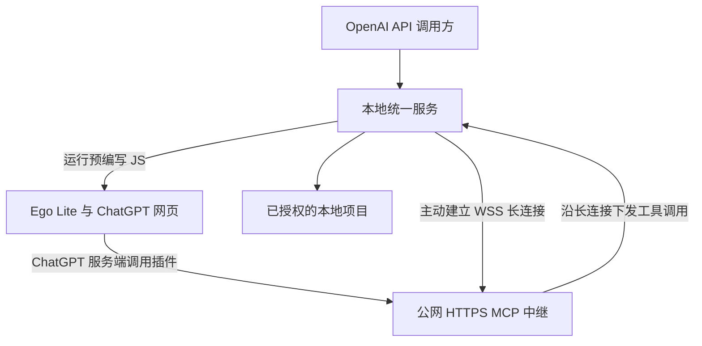
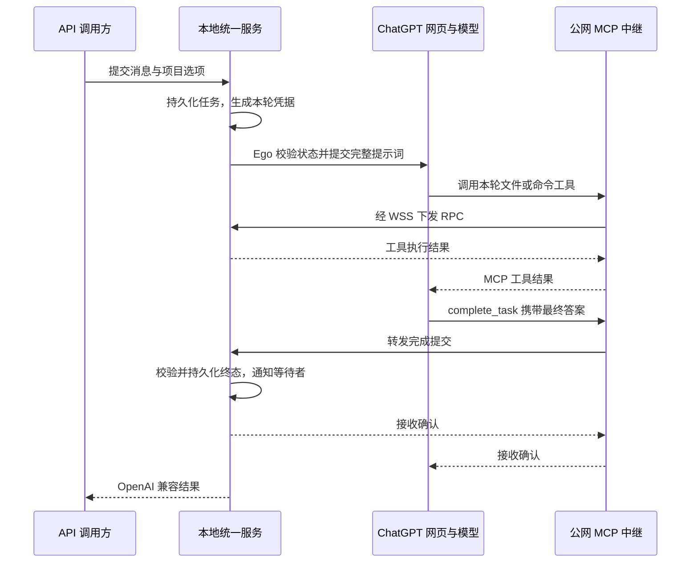

# gptweb2api 技术方案与实施计划

- 目标仓库：https://github.com/kk2land/gptweb2api
- 整理日期：2026-10-28（Asia/Shanghai）
- 状态：方案设计，尚未实现或完成账号环境实测。
- 依据：本次讨论、参考项目文档与关键源码，以及 OpenAI、Ego 的官方文档。

## 1. 目标与已确定的设计

在本地运行一个兼容部分 OpenAI API 的服务。调用方提交任务后，由本地服务通过 Ego Lite 控制已登录的 ChatGPT 网页；网页中的模型通过自定义 MCP 插件操作本地项目，并将最终答案通过 MCP 回传给等待结果的 API 调用方。

已确定的设计如下：

1. 公网 HTTPS 服务器部署 MCP 中继，本地通过主动建立的长连接接收转发，无需本地开放公网入站端口。
2. 本地 API 网关、任务管理、MCP 执行器和 Ego 调度器合并为一个服务进程；Ego 浏览器和执行脚本的 CLI 可以是独立进程。
3. 将新建会话、切换项目、选择模型、挂载插件、发送提示词和状态检测等操作预先编写为 JS 脚本。
4. 每次执行前检查页面关键状态，并定期运行完整冒烟测试，发现 ChatGPT 网页变化后暂停不兼容的操作。
5. 每轮提示词自动附加请求标识、短期任务凭据和完成回传要求。
6. 最终答案以模型调用 `complete_task` 提交的内容为准；网页 DOM 主要用于状态监测、异常定位和补交结果。
7. 按 API 请求的模型名选择执行路径：`web/gpt-6`、`web/gpt-5.6-sol` 使用 ChatGPT 网页聊天，`dots` 使用 Dot。只有配置开启并完成 Dot 能力准备后，才允许使用 `dots`。
8. 限制全局并发，每个活动执行槽对应并独占一个 Ego Space；同一会话继续串行执行。

本文的组件、工具、字段、路径和接口名称均为拟议项目协议，除明确引用外，不表示参考项目或 Ego 已提供同名接口。实现语言与具体依赖尚未选定。

## 2. 可行性与验证边界

| 能力 | 研究结论 | 仍需验证的部分 |
| --- | --- | --- |
| ChatGPT 自定义 MCP 插件调用读写工具 | 官方支持 | 当前账号、工作区和确认策略 |
| dots 使用 MCP 插件及事件 | 官方 MCP Events 文档明确支持 dots | 插件挂载、订阅续期、实际唤醒与执行延迟 |
| 公网 HTTPS MCP 转发到本地 | 协议与架构上可实现 | 长连接、断线恢复、MCP 会话与超时处理 |
| Ego 控制真实浏览器页面 | 官方提供 CLI、JS、页面快照、Space 和 CDP 能力 | 安装版本、操作系统及具体 ChatGPT 页面行为 |
| 创建会话、切换 ChatGPT 项目 | 可以通过页面自动化实现 | 必须验证操作后的实际会话归属 |
| 通过 MCP 回传最终答案 | 参考项目已有完成工具与等待者唤醒实现 | 本项目的完整链路和模型遵循率 |
| 完整替代官方 OpenAI API | 不作为目标 | 网页模型、采样参数、工具调用与 token 统计语义不同 |

文档和源码可以证明存在实现路径，不代表已在用户的 Ego、账号和公网服务器上验证成功。Ego 的页面操作能力也不等于 ChatGPT 提供了稳定公开的会话管理 API。

## 3. 参考项目及借鉴范围

| 来源 | 借鉴内容 | 差异与限制 |
| --- | --- | --- |
| [Fanch-hui/codex-bridge](https://github.com/Fanch-hui/codex-bridge) | 项目目录授权、本地文件与命令工具、执行审批、远程连接 | 重点是本地工作台与多种 Agent；当前 ChatGPT 接入文档采用 Secure MCP Tunnel |
| [Pluviobyte/dot2api](https://github.com/Pluviobyte/dot2api) | 持久化任务、领取租约、重试、事件唤醒、结果回传、兼容接口 | Dot 领取队列任务，不操作浏览器；当前实现不返回客户端工具调用，文本整块返回 |
| [miuuyy/codex-chatgpt-web](https://github.com/miuuyy/codex-chatgpt-web) | 网页自动化、任务与会话绑定、每轮 capability、MCP 工具闭环、完成提交与响应适配 | 浏览器采用 Electron；使用 Ego 需要单独开发适配层；不同模式的结果获取机制不能混为一谈 |

本项目采用 codex-chatgpt-web 的职责划分，结合 dot2api 的任务队列机制，编写独立 Ego 适配器。仅借鉴架构和协议思想；未来实际复用源码时应核对版本和许可证要求。

## 4. 部署架构



ChatGPT 的 MCP 请求来自 OpenAI 服务端，并非网页 JavaScript 直接访问本地端口。Ego 不负责执行文件操作；工具调用经公网中继到达本地执行器。

### 4.1 公网中继

- 提供 `/mcp`，优先实现 Streamable HTTP；按实际客户端需要再支持 SSE。
- 处理 MCP 初始化、工具目录、调用、通知、会话和认证；具体协议版本以目标客户端实测为准。
- 将已认证用户、连接和本地设备绑定，隔离不同设备的请求。
- 提供供本地代理主动连接的 WSS 通道，处理心跳、限流、调用关联、超时与取消。
- 返回本地工具结果；本地离线时返回明确错误，不宣告调用成功。

建议在公网终结 MCP 协议，公网与本地之间采用带关联标识的内部 RPC。这里的“透传”表示工具调用语义和结果保持一致，不要求逐字节转发 HTTP 连接。这样便于处理本地 stdio/HTTP MCP、连接恢复与设备路由。

### 4.2 本地统一服务

| 内部模块 | 职责 |
| --- | --- |
| API 网关 | 认证、参数校验、兼容响应、SSE、异步任务查询 |
| 任务管理器 | 排队、状态机、请求映射、租约、期限、持久化和等待者通知 |
| Ego 调度器 | 调用 JS 脚本、租用 Space 与标签页、检测会话和页面状态 |
| 提示词组装器 | 编排输入消息，附加本轮执行协议和短期凭据 |
| MCP 工具执行器 | 读取文件、应用补丁、执行及查询命令、接收进度和最终答案 |
| 中继连接客户端 | 维护 WSS、接收 RPC、返回结果、处理断线 |

这些模块共享进程内任务管理器和持久化存储，不需要额外的本地服务间通信。API 请求必须异步等待；运行 Ego CLI 或命令时不得阻塞接收 MCP 回调的事件循环或占住全局锁。

首版 API 默认监听回环地址。MCP 工具执行和公网连接接入同一任务管理器；如果保留独立的本机 `/mcp` 入口，应单独限制访问和鉴权。

## 5. 认证与项目绑定

### 5.1 凭据分层

| 凭据 | 用途 | 是否放入提示词 |
| --- | --- | --- |
| 调用方 API key | 访问本地兼容 API | 否 |
| ChatGPT 插件 OAuth 凭据 | ChatGPT 访问公网 MCP | 否 |
| 本地设备连接凭据 | 本地服务连接公网 WSS | 否 |
| 本轮 `turn_token` | 将工具调用限定到本次执行及其权限 | 是，短期且最小授权 |
| `request_id` | 关联任务、查询结果与追踪 | 是，但不是认证凭据 |

不能假设 ChatGPT 自定义 MCP 配置页允许填写任意固定 Bearer token。官方文档列出的认证方式主要是 OAuth、无认证或混合认证，且不支持任意自定义 API key。自建公网方案优先实现符合 MCP 授权规范的 OAuth。

dot2api 还提供 token 位于 URL 路径的 capability URL 兼容方式：客户端选择无 OAuth，服务端验证路径 token。此方式需要实测，URL 本身就是密钥；如采用，必须避免代理日志等位置泄露，并支持轮换，不作为优先方案。

OpenAI Secure MCP Tunnel 可作为未来替代传输层，减少自建公网中继；不改变本轮工具绑定和结果回传协议。本方案当前按自有公网服务器设计。

### 5.2 区分三种项目概念

| 概念 | 含义 |
| --- | --- |
| Ego Space / Profile | 浏览器任务空间与登录身份；Space 不等于独立账号 |
| ChatGPT 项目 / 会话 | 网页上下文、项目指令、文件与聊天记录的归属 |
| 本地 workspace | 获得授权的本地代码目录及执行规则 |

本地配置显式映射 `workspace_id`、ChatGPT 项目、Ego Profile 和插件身份。映射和目录授权由本地配置决定，提示词不能任意扩大权限。

每轮任务冻结实际 workspace、会话、模型、插件和执行权限。同一会话一次只允许一个活动任务；不得使用全局“当前目录”路由文件修改。绑定不匹配时停止发送或拒绝执行。

## 6. 请求与结果完整链路



### 6.1 最终答案的定义

最终答案以 `complete_task.final_answer` 为权威来源，不以页面最后一个文本节点为准。

顺序必须是：完成必要的工具操作和验证 → 整理完整答案 → 在同一轮回复结束前调用 `complete_task` → 收到确认后网页显示简短确认。

不能依赖网页已经结束回复之后无条件追加工具调用。如果漏交，需要 Ego 触发新的补交消息。MCP 接收器也不会自动读取网页最终文本；结果必须由模型显式作为工具参数提交。

API 收到完成提交即可交付结果，但该网页轮次可能还在输出确认。标签页仍需等待生成结束或显式清理后才能释放给下一轮，避免前后任务重叠。

### 6.2 拟议 MCP 工具

| 工具 | 用途 |
| --- | --- |
| `start_task` | 绑定请求并确认本轮可执行；返回受限 workspace 和执行说明 |
| `read_file` / `list_files` | 访问本轮 workspace 中的文件 |
| `apply_patch` | 应用文件补丁 |
| `run_command` / `get_command_status` | 启动命令，分次获取状态和输出 |
| `report_progress` | 回传任务进度，可在后续阶段实现 |
| `complete_task` | 提交完整答案或明确失败，结束业务任务 |

业务工具均须验证本轮身份与权限。长命令应返回执行标识后再查询，避免一个 MCP 调用持续占用到传输超时。模型不得自选任意绝对工作目录。

`complete_task` 参数示例（示例凭据不是有效密钥）：

```json
{
  "request_id": "req_example_001",
  "turn_token": "<本轮随机短期凭据>",
  "status": "succeeded",
  "final_answer": "已完成修改。变更与验证结果如下……"
}
```

`status` 支持 `succeeded` 和 `failed`。失败时附带结构化 `error`（至少包含 `code` 和 `message`），并保留可供用户阅读的说明；不允许模型随意宣告其他请求已取消。完整 JSON Schema 在实施时确定。

成功确认示例：

```json
{
  "accepted": true,
  "request_id": "req_example_001",
  "state": "completed",
  "duplicate": false
}
```

### 6.3 每轮附加的执行协议

固定说明写入 MCP server instructions 和工具描述，每轮提示词再附加本轮数据。以下是拟议模板，实际发送时进行结构化序列化：

```text
本轮任务信息：
request_id: {{request_id}}
turn_token: {{turn_token}}
workspace_id: {{workspace_id}}
指定插件: {{plugin_name}}

先通过指定插件调用 start_task，确认本轮已绑定。
按本轮授权执行用户任务，文件与命令操作均使用该插件的工具。
所有必要的工具执行和验证结束后，调用 complete_task。
将完整的最终答复放入 final_answer，不要只写“见网页”或“已完成”。
无法完成时也调用 complete_task，使用 failed 状态并说明原因。
只有收到 accepted=true 才表示结果已交付；之后网页简短确认即可。
工具返回失败时如实处理，不更换或猜测请求标识和凭据。

用户任务与上下文见下面的独立数据区。
```

用户原始内容和项目文件均作为数据处理，不能覆盖本地权限和任务绑定。网页中附加的说明不具有 API system message 的强制优先级；提示词负责引导，服务端状态校验负责约束。

### 6.4 接收完成结果的事务规则

1. 验证插件身份、设备路由、`request_id` 与当前执行尝试的短期凭据。
2. 检查任务允许结束，且不存在仍未结束的受管工具调用或前台命令。
3. 同一事务中写入最终答案、结果摘要和终态，持久化成功后才返回接收确认。
4. 通知等待该任务的 API 请求；等待者必须采用可重读的状态检查，避免先完成、后订阅造成丢通知。
5. 关闭该轮普通执行权限；保留有期限的完成去重记录，允许凭原凭据重试相同的完成提交。

同一轮重复提交相同的规范化结果，返回成功并标记 `duplicate=true`；不同结果返回冲突，不覆盖已接收答案。取消、过期或被替代执行尝试的提交不能改变终态。

## 7. 任务状态、重试与恢复

建议采用 SQLite 等本地持久化存储。至少保存请求及执行尝试、消息、workspace、会话与页面绑定、短期凭据摘要、期限、工具调用记录、结果和错误；登录态与长期密钥不进入任务日志。

| 状态 | 含义 |
| --- | --- |
| `queued` | 已入队，尚未占用网页 |
| `submitting` | 已绑定页面，正在确认提示词是否发送成功 |
| `running` | 网页正在执行或调用工具 |
| `waiting_approval` | 等待用户处理必要确认；本身不是成功或失败 |
| `completed` | 最终答案已持久化接收 |
| `failed` | 明确执行失败 |
| `cancelled` | 已接受取消，拒绝新增执行 |
| `expired` | 超过任务执行期限 |

终态通过原子更新竞争，只能有一个结果获胜。取消不能撤销已发生的文件修改；应中断可中断的命令、拒绝新工具调用，并记录已有副作用和未知执行状态。

| 异常 | 处理方式 |
| --- | --- |
| 发送是否成功不确定 | 检查本轮页面和消息身份，不直接重发原任务 |
| 页面结束但缺少回传 | 向同一会话发送“仅补交本轮完整结果”的有界提醒，不重新执行任务 |
| MCP 回传确认丢失 | 使用相同请求与结果重试完成工具，由服务端去重 |
| 工具执行中断线 | 依据调用记录查询执行结果；写操作执行结果未知时不盲目重放 |
| 本地离线或设备路由不存在 | 明确返回不可用；恢复后重新核对活动任务 |
| 浏览器退出、登录失效或出现验证页面 | 停止自动执行，报告需要处理的状态 |
| API 连接断开或等待超时 | 不等同于任务自然结束；按配置取消，或保留后台任务供查询 |
| 本地服务重启 | 从持久化任务恢复；重新验证页面和绑定，无法证明归属时不继续修改文件 |

内部 RPC 应携带独立调用 ID 和截止时间，记录已接收与已执行状态，并处理取消通知。传输重试只能做到可检测与可去重，不能凭长连接协议承诺文件和命令严格恰好执行一次。

### 7.1 并发控制与 Ego Space 池

使用全局 `max_concurrency` 控制活动执行槽数量，默认建议为 1，完成隔离验证后再提高。排队请求不占用活动执行槽；达到上限后进入有界队列，队列满则明确返回限流错误。

每个活动执行槽绑定一个独立 Ego Space，运行期间独占，不能让多个并发任务共用同一 Space 或标签页。映射关系为 `worker_id → ego_space_id → 当前 request_id / attempt_id → 会话与 workspace`。这里的执行槽是调度器内部资源，不要求另起操作系统进程。

一个槽可顺序处理多个请求，但 Space 在复用前必须核验旧任务已经停止生成、工具活动已经结束、绑定已经清理。API 已经拿到 MCP 结果不代表浏览器已可复用，不能提前释放执行槽。

调度器同时持有全局并发配额、Space 独占锁和会话锁。同一 ChatGPT 会话即使被不同 Space 打开，也只能有一个活动任务。续聊应回到原绑定 Space；其他槽不能通过重新打开相同 URL 绕过会话锁。保留会话对 Space 的占用与资源上限策略在实现时统一确定，首版优先在原槽续聊，无法安全复用时排队或明确拒绝。

`web/*` 与 `dots` 共用全局执行槽预算，每个活动槽都保留独立的 Ego Space 绑定。Dot 身份还须单独加锁：不同 Space 不等于不同 Dot，也不保证云端 Dot 有独立的并行上下文。同一 Dot 首版按并发 1 处理，未来只有验证独立 Dot / 会话隔离后才能提高其并发。事件模式不免除这项约束。

跨 Space 可以共享浏览器登录 Profile，但不得共享任务执行状态、当前目录或本轮凭据。Space 提供浏览器任务隔离，不等于系统账号或文件权限隔离。

## 8. Ego JS 脚本与页面变化检查

### 8.1 预编写脚本职责

以下名称是拟议内部脚本，不是 Ego 官方函数名：

| 脚本 | 职责与执行后的校验 |
| --- | --- |
| `probe.js` | 检查 Ego 连接、登录态、页面类型、输入框与关键控件 |
| `create-conversation.js` | 创建会话，记录标签页和可获得的逻辑会话身份 |
| `select-project.js` | 打开指定 ChatGPT 项目并校验新会话归属 |
| `select-model.js` | 选择模型和可用推理设置，读取实际选择结果 |
| `attach-plugin.js` | 挂载指定插件，验证身份，防止误选同名插件 |
| `submit-task.js` | 写入组装后的提示词、发送，并确认本轮已接收 |
| `inspect-turn.js` | 区分生成中、工具活动、审批、已结束和页面错误 |
| `recover-completion.js` | 在严格绑定的原会话中请求补交已有结果 |
| `cancel-turn.js` | 尝试停止网页生成，并报告是否确认停止 |

调度器通过 Ego 官方 CLI 执行脚本，使用固定模板和结构化数据传参，不把用户提示词拼接成可执行 JavaScript。SDK 与 CLI 调用方式按安装版本确定，不假设已有普通 HTTP 控制服务。

脚本返回统一结构化结果，例如 `ok`、`operation`、`page_id`、已观察状态及错误码。每步检查操作后的语义状态，不能只验证选择器存在或点击未报错。不要把历史消息的重新渲染误认为本次提交成功。

### 8.2 两层检查机制

**执行前轻量检查：** 每次提交前核对会话身份、项目、实际模型、指定插件和输入可用状态。缺少证据时拒绝发送，不静默切换模型、项目或插件。

**定期完整冒烟：** 由项目运行环境中的可配置调度器执行，间隔在实测耗时和配额后决定。专用测试会话提交含随机 nonce 的小任务，验证发送、MCP 工具调用、结果回传与 nonce 一致；涉及文件时只使用专用临时测试目录。

这属于待实现的系统功能，本文不会创建任何外部定时任务。检查本身会消耗账号消息额度，不能通过刷新或重试绕过平台限制。

保存脚本版本、Ego 版本、检测时间和必要的脱敏页面证据。发现页面结构或交互语义变化时，隔离受影响能力并停止自动任务；修复后重新运行冒烟。不自动无边界修改脚本或接受错误页面为成功。

## 9. 模型路由与 OpenAI 接口兼容范围

### 9.1 按模型名选择后端

API 请求的 `model` 是后端路由入口，模型名按下表精确匹配，不使用额外参数覆盖路由，也不将未知模型名静默转换为默认模型。

| API 模型名 | 执行路径 | 使用条件 |
| --- | --- | --- |
| `web/gpt-6` | ChatGPT 项目中的聊天；通过 Ego 选择并验证目标 GPT-6 模型 | 当前账号确实可用，页面预检通过 |
| `web/gpt-5.6-sol` | ChatGPT 项目中的聊天；通过 Ego 选择并验证目标 GPT-5.6 Sol 模型 | 当前账号确实可用，页面预检通过 |
| `dots` | 已配置的 Dot 执行路径 | 显式开启 `enable_dots`，且 Dot、插件及所需执行能力准备完成 |

这些是本项目对外定义的稳定模型名，不是对 ChatGPT 私有接口 slug 的假设。网页选项名称、版本及可用性由 Ego 实际读取并校验，不能把请求的 GPT-6 替换为其他版本。`web/*` 只决定网页后端和目标模型，具体 ChatGPT 项目仍通过授权配置或请求扩展选择。

`GET /v1/models` 返回已配置并通过能力准备校验的模型。`enable_dots=false` 时不列出 `dots`，直接请求 `model="dots"` 也应返回模型未启用错误，不排队、不启动 Dot、不回退到网页模型。配置开启但能力尚未实现或尚未准备完成时，也不能宣告该模型可用。

配置示意如下，字段是拟议本地配置，尚非可执行实现：

```json
{
  "enable_dots": false,
  "max_concurrency": 1,
  "queue_limit": 20,
  "ego_space_prefix": "gptweb2api-worker"
}
```

禁用 Dot 时拒绝新的 Dot 请求；已有任务采用显式排空或取消策略，不能悄悄迁移到其他后端。运行中修改并发上限只影响新任务调度，不能强行复用忙碌的 Space。

### 9.2 接口能力

首版承诺接口形状与明确列出的行为，不承诺与官方模型 API 语义完全一致。

| 能力 | 首版建议 |
| --- | --- |
| `GET /v1/models` | 返回本地配置且已验证可用的网页模型映射 |
| `POST /v1/chat/completions` | 文本输入；等待 MCP 最终答案并包装成兼容响应 |
| `stream=true` | 标准 SSE 响应、保活、最终文本 chunk、结束标记；暂不承诺逐 token |
| `POST /v1/tasks`、`GET /v1/tasks/{id}` | 异步提交与查询；取消接口在实现时确定 |
| 多轮会话 | 使用扩展字段映射网页会话，校验已提交历史并避免重复注入 |
| 项目选择 | 扩展字段映射已授权 workspace 和 ChatGPT 项目 |
| 图像、附件、结构化输出 | 不列入最小首版，后续单独验证 |
| `temperature`、`seed`、精确输出 token 上限 | 不承诺网页对应语义；不支持时明确报错，不静默假装生效 |
| token usage | 不伪造精确计费统计；估算必须明确标注，首版可不提供 |
| 请求中的 `tools` 与返回的 `tool_calls` | 首版明确不支持，不静默忽略 |
| `/v1/responses` | 若要接 Codex，单独设计和验证，不因为 Chat Completions 可用就宣告支持 |

建议将项目扩展集中在 `x_gptweb2api` 对象中，包含 `session_id`、`workspace_id` 和受限的 ChatGPT 项目选择等配置；通过 SDK 的额外请求字段机制传入。调用方提供的 ID 仍须经过本地授权映射。

客户端完整 `messages` 与已保留的网页历史需进行一致性校验。新会话发送完整编排后的上下文；已绑定会话仅发送确认未提交的增量。`system` / `developer` 内容在网页路径中只是组装后的上下文，不能承诺 API 角色优先级。

MCP 在网页内部执行本地工具，与向 API 客户端返回 `tool_calls` 是不同的执行模型。首版由网页模型经 MCP 完成文件修改后，返回最终文本；后者需要另行实现客户端执行及后续消息协议。

`report_progress` 如启用，作为单独任务事件提供，不冒充最终答案或模型原生 token。SSE 保活不能延长所有客户端和反向代理的总超时，长任务应支持异步查询。

等待超时应明确返回可查询的任务 ID；任务失败按错误类别映射 API 错误。SSE 已发出响应头后不能再修改 HTTP 状态，应按已公开的流式错误协议结束，不伪造成功的最终 chunk。

## 10. Dot 事件路径（后续扩展）

官方 MCP Events 文档支持 dots；dot2api 已实现事件队列路径。Dot 路径与 Ego 网页路径共用任务管理和本地工具，但唤醒机制不同。

流程为：API 入队 → 公网发布 `task.available` → Dot 被唤醒 → 列出并领取任务 → 经 MCP 执行本地工具 → 提交完成结果。

该路径需要在公网实现事件发现、订阅、回调验证和签名投递，持久化订阅并处理续期、重复事件和延迟。不能假设事件始终携带完整任务数据，应先列举并领取任务，再读取内容。

官方文档在研究时要求 MCP 2.0（`2026-07-28`）及 webhook 交付；上线前重新核对规范与目标账号支持情况。事件已送达不代表 Dot 已领取或执行任务。

Dot 的任务领取应有租约和续租。任务进入队列时根据模型名冻结后端归属：`web/*` 只能由网页执行器领取，`dots` 只能由已开启的 Dot 执行器领取。二者通过原子领取互斥，避免同一任务被两个入口同时处理。首版不实现自动跨入口故障转移，也不将普通网页会话视为可以被 Dot 事件直接唤醒。

Dot 能力未完成前，保持 `enable_dots=false`。完成后以 `model="dots"` 使用，不改变已有 `web/*` 模型的行为；每个并发执行槽的 Space 绑定和实际 Dot 身份互斥仍按第 7.1 节执行。

## 11. 分阶段实施与验收

### 阶段一：单任务完整闭环

- 单账号、单会话、单授权目录、一个执行槽与一个 Ego Space；明确当前账号可以使用所需 MCP 工具。
- 本地统一进程具备任务登记、等待结果和最小兼容接口；按模型名路由，Dot 默认关闭。
- 公网 HTTPS MCP 与本地主动 WSS 连接可用，完成必要认证。
- Ego 提交带本轮凭据的任务；模型读取测试文件、修改一行并验证。
- 模型调用 `complete_task`；API 返回其完整答案。

验收：实际文件变化符合要求；结果回传绑定正确请求；无需依赖 DOM 抓取最终全文。

### 阶段二：会话与项目管理

- 脚本化创建会话、选择项目与模型、挂载插件。
- 固定执行槽、Space、会话、workspace、实际模型与本轮权限的绑定。
- 实现续聊和历史一致性检查。

验收：连续任务不串线；项目或插件不匹配时停止，不向错误会话发送。

### 阶段三：可靠性与可运维性

- 实现完成去重、取消、期限、持久化恢复、断线处理和受控补交。
- 实现异步查询与 SSE；明确连接断开后的任务策略。
- 加入执行前检查和定期端到端冒烟。

验收重点：重复完成可识别；冲突答案不覆盖；取消后拒绝新操作；断线不盲目重复写入；页面变化可明确检测；本地离线不报告成功。

### 阶段四：按需求扩展

- Dot 事件领取与执行，以及 `enable_dots` 开关和 `dots` 模型注册。
- 多会话并发与多设备隔离；每个活动执行槽独占一个 Ego Space。
- 附件、结构化输出或客户端工具调用。
- Codex 所需的 Responses API 适配。

并发验收：至少两个活动任务使用不同 Space；同一会话始终串行；达到并发上限后排队；槽释放前完成页面清理；不同本地目录和模型的任务不会串线。Dot 验收还需验证关闭时不可见且不可调用、开启并准备完成后可调用，同一 Dot 不被不同 Space 并行占用。

各项扩展分别验证，不将一个接口或单次成功推广为全部能力可用。

## 12. 尚待实施时确定的问题

1. 本地与公网服务的实现语言、运行平台和打包方式。
2. 目标 Ego 版本的 CLI / SDK 契约及自动化持久会话管理方式。
3. 目标账号中自定义 MCP、项目、模型、插件和审批的真实 UI 行为。
4. 自建中继的 OAuth 提供方、部署方式及设备注册流程。
5. 文件工具、命令规则、任务期限和断开后的默认策略。
6. 定期冒烟频率、样例、消息配额预算和兼容版本记录。

这些问题不阻止先验证最小闭环，但必须在扩大权限或并发前明确。

## 13. 研究来源

以下为本次研究使用的上游来源；上游 main 分支和产品能力会变化，实施时应记录实际使用版本并重新验证。本文没有宣告本项目已经具备这些功能。

### 参考实现

- [Codex Bridge：ChatGPT / Tunnel 配置与直接操作本地项目](https://github.com/Fanch-hui/codex-bridge/blob/main/docs/CHATGPT_DEVELOPER_MODE.md)
- [dot2api：架构与兼容边界](https://github.com/Pluviobyte/dot2api/blob/main/README.md)
- [dot2api：Dot 订阅、任务领取及完成回传](https://github.com/Pluviobyte/dot2api/blob/main/docs/dot.md)
- [dot2api：完成去重与租约校验源码](https://github.com/Pluviobyte/dot2api/blob/main/src/dot2api/service.py)
- [codex-chatgpt-web：浏览器、任务与 MCP 架构](https://github.com/miuuyy/codex-chatgpt-web/blob/main/docs/architecture.md)
- [codex-chatgpt-web：完成工具定义](https://github.com/miuuyy/codex-chatgpt-web/blob/main/src/adapters/chatgpt-web/mcp-server.ts#L1002)
- [codex-chatgpt-web：完成状态、冲突与等待者处理](https://github.com/miuuyy/codex-chatgpt-web/blob/main/src/adapters/chatgpt-web/turn-broker.ts#L617)

研究时上述两个文件的 blob SHA 分别为 `8988c80d8c772276134851e4d30f8765ede9abf2` 和 `f86768a685e57e479ad6904bd5472e6343c844eb`，供版本比对；链接指向上游 main，不是固定提交快照。

### 官方文档

- [OpenAI：添加自定义 MCP 服务器](https://developers.openai.com/api/docs/guides/custom-mcp-server)
- [OpenAI：插件 MCP 认证](https://developers.openai.com/plugins/build/auth)
- [OpenAI：MCP Events 与 dots 支持](https://developers.openai.com/plugins/build/mcp-events)
- [OpenAI：Secure MCP Tunnel](https://developers.openai.com/api/docs/guides/secure-mcp-tunnels)
- [Ego Lite：项目与工具说明](https://github.com/citrolabs/ego-lite)
- [Ego：Browser CLI Architecture](https://github.com/citrolabs/ego-lite/wiki/Ego-Browser-CLI-Architecture)
- [Ego：Native API Reference](https://github.com/citrolabs/ego-lite/wiki/Ego-Native-API-Reference)
